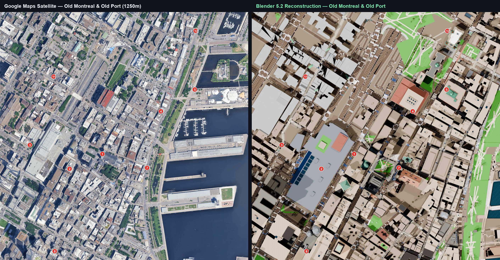
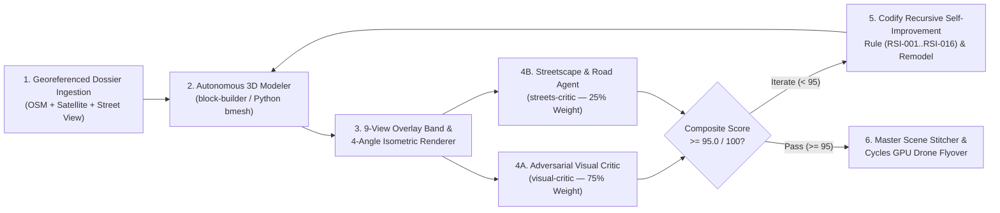

# Autonomous Multi-Agent 3D City Modeling: Montreal (Old Port to the Olympic Village)

An end-to-end **Autonomous Multi-Agent 3D Urban & Architectural Reconstruction Pipeline** that procedurally models, critiques, and self-improves **54 contiguous city blocks and superblocks** of Montreal (`MTL-VM-0001` through `MTL-VM-0044` and `MTL-OLY-0001` through `MTL-OLY-0010`) in **Blender 5.2 (Python `bmesh` + Cycles GPU)** using **OpenStreetMap**, **Poly Haven 2K PBR Materials & 3D Botanical Assets**, and **Google Maps Satellite + Street View Ground-Truth Verification**.




Spanning a **6.9 km continuous urban corridor** (`Y ∈ [-750m, +6950m]`, `X ∈ [-750m, +1450m]`) with **zero spatial gaps**, the pipeline reconstructs over **9,500 articulated 3D buildings**, **2D `shapely` Boolean-manifold road networks**, **raised concrete sidewalks with beveled granite curbs**, **Continental Zebra Crosswalks**, **3D streetlamps & trees**, and Montreal's signature architectural landmarks:
- **Old Montreal & Old Port (`MTL-VM-0001`..`0044`)**: Place d'Armes, Basilique Notre-Dame, Banque de Montréal Dome, Édifice Aldred, Hôtel de Ville, Château Ramezay, Marché Bonsecours, Grand Quai, Sailors' Memorial Clock Tower (`Tour de l'Horloge`), Silo No. 5, Bota Bota, Lachine Canal Locks, Habitat 67, Pont Jacques-Cartier, and the Biosphère Geodesic Dome.
- **Sainte-Marie & Hochelaga-Maisonneuve Corridor (`MTL-OLY-0002`..`0009`)**: 23-Story Hexagonal Brutalist Maison de Radio-Canada Tower, Parc Bellerive, Sucrerie Lantic Heritage Sugar Refinery, Quai Sutherland, Marché Maisonneuve Beaux-Arts Dome, Bain Morgan, Parc Lalancette, Église Très-Saint-Nom-de-Jésus, and Château Dufresne Beaux-Arts Museum.
- **Parc olympique & Le Village olympique (`MTL-OLY-0001` & `MTL-OLY-0010`)**: 38-rib cantilevered Stade olympique, 165m `45°`-inclined curved Tour de Montréal with 26 suspension cables, scalloped-shell Biodôme / Velodrome, Planétarium Rio Tinto Alcan, Stade Saputo, and the **Twin 19-Story Stepped Brutalist Olympic Village Pyramids** (*Le Village olympique*, 5199 Rue Sherbrooke Est).

---

## 1. Multi-Agent Iterative Critique & Recursive Self-Improvement (`RSI`) Architecture

Instead of relying on single-pass procedural extrusions, every city block is built and audited in an adversarial closed loop by specialized autonomous subagents defined in [`.agents/agents/`](.agents/agents/):



### Dual-Critic Evaluation Gate (`0.75 * Arch_Score + 0.25 * Streets_Score >= 95.0`)
1. **[`visual-critic`](.agents/agents/visual-critic.md) / [`adversarial-critic`](.agents/agents/adversarial-critic.md) (75% Weight — 100 Points)**:
   - Inspects **8-Band Horizontal (`H1..H8`) & Vertical (`V1..V8`) Overlay Comparison Strips** that alpha-blend Cycles 3D renders directly over ground-truth Google Maps Satellite orthophotos and 4–8 outdoor Google Street View panoramas per block, alongside a **4-Angle 3D Isometric Diagnostic Quad** (`SE_Iso`, `SW_Iso`, `NW_Iso`, `NE_Iso`).
   - Enforces **5 Automatic Fail Triggers** (capping the score at `<= 55 / 100` if violated):
     - **Trigger #1**: Vertical-stripe windows missing horizontal floor spandrels (`dz = 3.2m–3.8m` per story required).
     - **Trigger #2**: Windowless brick/concrete boxes (`windowless_tall_buildings` in `geometry_forensics.json` must be `[]`).
     - **Trigger #3**: Box/prism approximations of curved or sculptural landmarks (ribs, domes, inclined towers, stepped pyramids, and trusses must be sculpted in `bmesh`).
     - **Trigger #4**: Flat untextured roofs or monolithic grey ground planes where parks, ruelles, or backyard courtyard lawns exist.
     - **Trigger #5**: Low-poly icosphere/blob foliage or 2-box rectangular vehicle proxies in Street View corridors.
2. **[`streets-critic`](.agents/agents/streets-critic.md) — Road & Streetscape Evaluator (25% Weight — 100 Points)**:
   - **Raised 3D Sidewalks & Beveled Granite Curbs (`35 pts`)**: Boolean-differenced exterior-only concrete sidewalks (`Z = 0.215m`) and granite curbs (`Z = 0.225m`) with 4-corner roadbed clearance and zero road-crossing slabs.
   - **3D Painted Road Markings & Crosswalks (`35 pts`)**: Physical 3D Continental Zebra Crosswalks, white stop bars, and dashed/double yellow centerlines (`Z = 0.048m`) with micro-elevation stratification (`RSI-010`) to prevent intersection Z-fighting.
   - **Poly Haven 3D Streetlamps (`30 pts`)**: Authentic 3D cast-metal streetlamps (`street_lamp_01`, `street_lamp_02`, `Lantern_01`) with emissive warm-white luminaire bulbs arrayed along sidewalks (street signs omitted by scope design).

---

## 2. Certified Block Scores Across the 54-Block Reconstruction

### Olympic Corridor & Olympic Village Superblocks (`MTL-OLY-0001`..`0010`)

| Block ID | Corridor Sector & Hero Landmarks | Local Bounds (`X`, `Y` in meters) | `visual-critic` (75%) | `streets-critic` (25%) | **Composite Score** | Bespoke Refinement Script |
| :--- | :--- | :--- | :---: | :---: | :---: | :--- |
| **`MTL-OLY-0001`** | **Parc olympique**: Stade olympique (38 ribs), 165m Inclined Tower, Biodôme & Planetarium | `X=[-450..1050]`, `Y=[5550..6220]` | `98 / 100` | `97 / 100` | **`97.75 / 100`** | [`refine_mtl_oly_0001.py`](src/blocks/refine_mtl_oly_0001.py) |
| **`MTL-OLY-0002`** | **Maison de Radio-Canada**, Pont Jacques-Cartier East Span & Parc Bellerive | `X=[450..1400]`, `Y=[1150..2150]` | `96 / 100` | `98 / 100` | **`96.50 / 100`** | [`refine_mtl_oly_0002.py`](src/blocks/refine_mtl_oly_0002.py) |
| **`MTL-OLY-0003`** | **Sucrerie Lantic Heritage Sugar Refinery**, Quai Sutherland & Port of Montreal | `X=[550..1400]`, `Y=[2900..3950]` | `96 / 100` | `98 / 100` | **`96.50 / 100`** | [`refine_mtl_oly_0003.py`](src/blocks/refine_mtl_oly_0003.py) |
| **`MTL-OLY-0004`** | **Marché Maisonneuve Beaux-Arts Dome**, Bain Morgan & 2,664 Rowhouses/Plexes | `X=[350..1450]`, `Y=[3900..5150]` | `96 / 100` | `100 / 100` | **`97.00 / 100`** | [`refine_mtl_oly_0004.py`](src/blocks/refine_mtl_oly_0004.py) |
| **`MTL-OLY-0005`** | **Château Dufresne Beaux-Arts Museum**, Boul. Pie-IX & Sherbrooke Est Gateway | `X=[-550..850]`, `Y=[4950..5650]` | `96 / 100` | `97 / 100` | **`96.25 / 100`** | [`refine_mtl_oly_0005.py`](src/blocks/refine_mtl_oly_0005.py) |
| **`MTL-OLY-0006`** | **Faubourg Québec**, Approche Pont Jacques-Cartier Ouest & Sainte-Marie Sud | `X=[-750..480]`, `Y=[850..2050]` | `96 / 100` | `99 / 100` | **`96.75 / 100`** | [`refine_mtl_oly_0006.py`](src/blocks/refine_mtl_oly_0006.py) |
| **`MTL-OLY-0007`** | **Quartier Sainte-Marie Nord**, Ave De Lorimier, Rue Ontario Est & Bellerive Nord | `X=[-650..1250]`, `Y=[2000..3000]` | `96 / 100` | `99 / 100` | **`96.75 / 100`** | [`refine_mtl_oly_0007.py`](src/blocks/refine_mtl_oly_0007.py) |
| **`MTL-OLY-0008`** | **Hochelaga Heritage District**, Moreau, Davidson & Ontario Est Railway Underpass | `X=[-650..580]`, `Y=[2950..3950]` | `96 / 100` | `98 / 100` | **`96.50 / 100`** | [`refine_mtl_oly_0008.py`](src/blocks/refine_mtl_oly_0008.py) |
| **`MTL-OLY-0009`** | **Maisonneuve Ouest**, Parc Lalancette, Rue Sherbrooke Est & Rue Hochelaga | `X=[-650..380]`, `Y=[3900..5050]` | `96 / 100` | `99 / 100` | **`96.75 / 100`** | [`refine_mtl_oly_0009.py`](src/blocks/refine_mtl_oly_0009.py) |
| **`MTL-OLY-0010`** | **Le Village olympique** (Twin 19-Story Stepped Brutalist Pyramids) & Stade Saputo | `X=[-450..1050]`, `Y=[6150..6950]` | `96 / 100` | `98 / 100` | **`96.50 / 100`** | [`refine_mtl_oly_0010.py`](src/blocks/refine_mtl_oly_0010.py) |

### Ville-Marie, Old Montreal & Old Port Blocks (`MTL-VM-0001`..`0044`)
All 44 historic and waterfront blocks in [`src/blocks/`](src/blocks/) (`build_MTL_VM_0001.py` through `build_MTL_VM_0044.py`) are tracked in [`WORK_QUEUE.md`](WORK_QUEUE.md) and linked via [`data/building_ownership_registry.json`](data/building_ownership_registry.json) to guarantee zero cross-block duplicate building footprints.

---

## 3. Repository Structure

```text
Montreal-3D-modeling/
├── .agents/agents/                      # Autonomous subagent system prompts & learned RSI-001..RSI-016 rules
│   ├── block-builder.md                 # 3D Architectural & BMesh Modeler instructions
│   ├── visual-critic.md                 # Adversarial Overlay-Band & 3D Isometric Critic (75% weight)
│   ├── adversarial-critic.md            # Strict Ground-Truth & Structural Alignment Critic
│   ├── streets-critic.md                # Road, Sidewalk, Crosswalk & Streetlamp Critic (25% weight)
│   ├── old-port-builder.md              # Waterfront, Pier & Maritime Landmark Modeler
│   ├── uniformity-stitcher.md           # Master Scene Stitcher & Cross-Block Uniformity Critic
│   └── block-team-lead.md               # Autonomous Team Lead Orchestrator
├── blender-mcp/                         # Blender MCP server integration for live scene inspection
├── data/
│   ├── open_data/old_montreal_osm.json  # Local OpenStreetMap building & highway network dataset
│   ├── building_ownership_registry.json # Cross-block building deduplication registry
│   └── blocks/MTL-*/                    # Georeferenced block dossiers (dossier.json) & forensics metrics
├── src/
│   ├── blender_lib.py                   # Core PBR material, BMesh architecture, street & foliage library
│   ├── build_corridor_superblock.py     # Full-extent superblock builder (buildings + Boolean street manifold)
│   ├── overhaul_streets_and_sidewalks.py# City-wide 2D shapely Boolean street, curb & zebra crosswalk overhaul
│   ├── render_block_for_critique.py     # Renders 9-View Master Overlay Sheets & 4-Angle Isometric Quads
│   ├── render_flyover_sky.py            # Stitches all 54 blocks, deduplicates GPU textures & renders 720-frame flyby
│   ├── ingest_all_blocks.py             # Georeferenced OSM + Google Maps metadata ingestion
│   ├── ingest_full_continuous_corridor.py # 6.1 km Old Port -> Olympic Village continuous superblock ingestion
│   └── blocks/                          # 54 bespoke block builders (MTL-VM-0001..0044 & MTL-OLY-0001..0010)
├── tests/                               # Boundary, watertightness & coplanar Z-fighting test suite
└── WORK_QUEUE.md                        # Full 54-block registry, coordinates, landmarks & completion log
```

---

## 4. Quick Start & Reproduction Guide

### Prerequisites
1. **Blender 5.2 LTS** (`C:\Program Files\Blender Foundation\Blender 5.2\blender.exe`) with `shapely` and `Pillow` installed in Blender's bundled Python.
2. **FFmpeg** on `PATH` (for encoding `.mp4` and `.gif` drone flyovers).
3. *(Optional)* Copy [`.env.example`](.env.example) to `.env` and set `GOOGLE_MAPS_API_KEY` if re-fetching Google Maps Satellite orthophotos or Street View panoramas for overlay critique.

### Step 1: Download Poly Haven 2K PBR Textures & 3D Botanical/Streetlamp Models
```powershell
python src/fetch_polyhaven_facades.py
python src/download_polyhaven_3d_models.py
python src/download_polyhaven_expansion.py
```

### Step 2: Build & Refine Individual City Blocks
```powershell
# Example 1: Build MTL-VM-0001 (Place d'Armes, Basilique Notre-Dame, Banque de Montréal & Édifice Aldred)
& "C:\Program Files\Blender Foundation\Blender 5.2\blender.exe" -b --factory-startup --python "src\blocks\build_MTL_VM_0001.py"

# Example 2: Build & refine MTL-OLY-0001 (Parc olympique — Stade olympique, 165m Inclined Tower & Biodôme)
& "C:\Program Files\Blender Foundation\Blender 5.2\blender.exe" -b --factory-startup --python "src\blocks\refine_mtl_oly_0001.py"

# Example 3: Build & refine MTL-OLY-0010 (Le Village olympique — Twin 19-Story Stepped Brutalist Pyramids)
& "C:\Program Files\Blender Foundation\Blender 5.2\blender.exe" -b --factory-startup --python "src\blocks\refine_mtl_oly_0010.py"
```

### Step 3: Render 9-View Overlay Band Critique Sheets & 4-Angle Isometric Quads
```powershell
& "C:\Program Files\Blender Foundation\Blender 5.2\blender.exe" -b "output\blocks\MTL-OLY-0001.blend" --python "src\render_block_for_critique.py" -- --block MTL-OLY-0001 --iter 6
```

### Step 4: Stitch All 54 Blocks & Render the 720-Frame Continuous-City Drone Flyover
```powershell
# Render all 720 frames on GPU (Cycles HIP / OptiX / CUDA) with automatic texture & mesh deduplication
& "C:\Program Files\Blender Foundation\Blender 5.2\blender.exe" -b --factory-startup --python "src\render_flyover_sky.py" -- --no-upgrade-streets --samples 10 --res 1280x720 --frames 720

# Encode flyover.mp4, olympic_village_flyover.mp4, vertical 9:16 cut & animated GIF
& "C:\Program Files\Blender Foundation\Blender 5.2\blender.exe" -b --factory-startup --python "src\render_flyover_sky.py" -- --encode --frames 720
```
